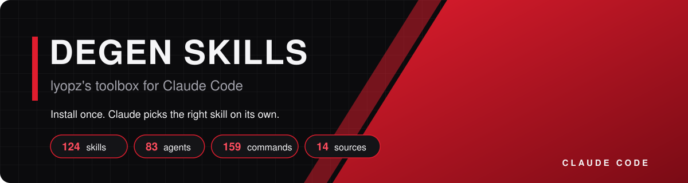
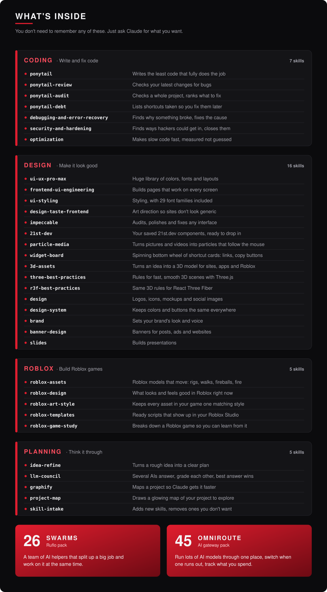

<p align="center"></p>

<p align="center">


</p>

## What is this?

A **skill** is a set of instructions that teaches Claude how to do one job really well, like fixing bugs or designing a logo.
This repo is a big bag of them. Once it's installed, you just talk to Claude normally and it grabs the right skill by itself.

<p align="center"></p>

## Try saying

| You say… | Claude uses… |
|:--|:--|
| "Why is my login page crashing?" | `debugging-and-error-recovery` |
| "Make me a landing page for my Shopify store" | `ui-ux-pro-max`, `frontend-ui-engineering` |
| "Make this button animation feel smoother" | `animate`, `emil-design-eng` |
| "Organize my Obsidian notes into a table" | `obsidian-bases`, `obsidian-markdown` |
| "Make my landing page look less generic" | `design-taste-frontend` |
| "Audit and polish this page's design" | `impeccable` |
| "Add my 21st.dev spotlight card to this page" | `21st-dev` |
| "Make my hero image break into particles when I move the mouse" | `particle-media` |
| "Add a widget board / tab wheel to the bottom of my site" | `widget-board` |
| "Make a 3D robot chicken / a Roblox prop" | `3d-assets` |
| "Make a Roblox fireball / make my chicken walk in Roblox" | `roblox-assets` |
| "Make my Roblox game 10,000x cooler" | `roblox-design` |
| "Make a pigeon cube pet that fits my game" | `roblox-art-style` |
| "Save this script to my Roblox Studio" | `roblox-templates` |
| "Break down this Roblox game so I can learn from it" | `roblox-game-study` |
| "Build a fast 3D scene for my site" | `three-best-practices`, `r3f-best-practices` |
| "Design a logo for my brand" | `design`, `brand` |
| "Is my code safe from hackers?" | `security-and-hardening` |
| "I have an idea for an app, help me plan it" | `idea-refine` |
| "Ask the council: should I use Postgres or SQLite?" | `llm-council` |
| "Show me a map of this project" | `graphify`, `project-map` |
| "Split this big job across a team of agents" | `swarm-orchestration`, `hive-mind-advanced` |
| "How much am I spending on AI?" | `cli-cost-usage`, `omni-budget` |

## 🟥 Obsidian pack — 6 skills

Official Obsidian skills from [Steph Ango](https://github.com/kepano/obsidian-skills), Obsidian's CEO. Claude writes and organizes notes in your vault properly.

| Skill | What it does |
|:--|:--|
| [`obsidian-markdown`](skills/obsidian-markdown/SKILL.md) | Writes notes the Obsidian way: links, callouts, tags |
| [`obsidian-bases`](skills/obsidian-bases/SKILL.md) | Builds table and card views of your notes |
| [`json-canvas`](skills/json-canvas/SKILL.md) | Makes Obsidian canvases, mind maps and flowcharts |
| [`obsidian-cli`](skills/obsidian-cli/SKILL.md) | Lets Claude search and edit your vault directly |
| [`defuddle`](skills/defuddle/SKILL.md) | Turns a web page into a clean note |
| [`knap`](skills/knap/SKILL.md) | Turns data into notes from templates |

## 🟥 Motion & polish pack — 15 skills

Make apps and websites feel smooth and polished: animations, phone feel, edge-case testing. From [Emil Kowalski](https://github.com/emilkowalski/skills).

<details>
<summary><b>Show all 15 Motion & polish skills</b></summary>

| Skill | What it does |
|:--|:--|
| [`animate`](skills/animate/SKILL.md) | Builds an animation that feels right |
| [`animate-expo`](skills/animate-expo/SKILL.md) | Animations for React Native / Expo apps |
| [`animation-performance`](skills/animation-performance/SKILL.md) | Fixes choppy, laggy animations |
| [`animation-vocabulary`](skills/animation-vocabulary/SKILL.md) | Tells you the name of a motion effect |
| [`apple-design`](skills/apple-design/SKILL.md) | Apple-style smooth, physical motion for web |
| [`ask-sonner`](skills/ask-sonner/SKILL.md) | Help with Sonner pop-up notifications |
| [`break-ui`](skills/break-ui/SKILL.md) | Stress-tests UI with worst-case data |
| [`emil-design-eng`](skills/emil-design-eng/SKILL.md) | Emil's rules for polished, great-feeling UI |
| [`find-animation-opportunities`](skills/find-animation-opportunities/SKILL.md) | Finds spots that should animate |
| [`improve-animations`](skills/improve-animations/SKILL.md) | Audits all animations, plans fixes |
| [`mobile-native`](skills/mobile-native/SKILL.md) | Makes web apps feel like real phone apps |
| [`pick-ui-library`](skills/pick-ui-library/SKILL.md) | Picks the right library (only when asked) |
| [`prototype`](skills/prototype/SKILL.md) | Several versions to flip between (only when asked) |
| [`review-animations`](skills/review-animations/SKILL.md) | Strict check of animations (only when asked) |
| [`write-swift`](skills/write-swift/SKILL.md) | Writing modern Swift for iPhone apps |

</details>

## 🟥 Swarms pack — 26 skills

Teams of AI helpers that each take a piece of a big job. Comes with **75 ready-made agents** (coder, tester, reviewer, planner…) in [`agents/`](agents) and **159 slash commands** in [`commands/`](commands).

<details>
<summary><b>Show all 26 Swarms skills</b></summary>

| Skill | What it does |
|:--|:--|
| [`agentdb-advanced`](skills/agentdb-advanced/SKILL.md) | Advanced setup for the agents' shared memory |
| [`agentdb-learning`](skills/agentdb-learning/SKILL.md) | Lets agents get better by learning from past jobs |
| [`agentdb-memory-patterns`](skills/agentdb-memory-patterns/SKILL.md) | Gives agents a memory that lasts between chats |
| [`agentdb-optimization`](skills/agentdb-optimization/SKILL.md) | Makes agent memory faster and smaller |
| [`agentdb-vector-search`](skills/agentdb-vector-search/SKILL.md) | Searches notes by meaning, not exact words |
| [`agentic-jujutsu`](skills/agentic-jujutsu/SKILL.md) | Version control built for many agents at once |
| [`browser`](skills/browser/SKILL.md) | Lets agents use a web browser |
| [`github-code-review`](skills/github-code-review/SKILL.md) | A team of agents reviews a pull request |
| [`github-multi-repo`](skills/github-multi-repo/SKILL.md) | Keeps several GitHub projects in sync |
| [`github-project-management`](skills/github-project-management/SKILL.md) | Handles GitHub issues and project boards |
| [`github-release-management`](skills/github-release-management/SKILL.md) | Plans and ships new versions |
| [`github-workflow-automation`](skills/github-workflow-automation/SKILL.md) | Sets up auto-testing and auto-deploying on GitHub |
| [`hive-mind-advanced`](skills/hive-mind-advanced/SKILL.md) | A lead agent runs a team of worker agents |
| [`hooks-automation`](skills/hooks-automation/SKILL.md) | Runs helpers automatically before and after actions |
| [`pair-programming`](skills/pair-programming/SKILL.md) | Codes alongside you like a partner |
| [`performance-analysis`](skills/performance-analysis/SKILL.md) | Finds what's slowing an agent team down |
| [`reasoningbank-agentdb`](skills/reasoningbank-agentdb/SKILL.md) | Remembers what worked so agents reuse it |
| [`reasoningbank-intelligence`](skills/reasoningbank-intelligence/SKILL.md) | Spots patterns in what works and adapts |
| [`skill-builder`](skills/skill-builder/SKILL.md) | Helps you make your own new skills |
| [`sparc-methodology`](skills/sparc-methodology/SKILL.md) | Step-by-step build plan: spec, plan, build, polish |
| [`stream-chain`](skills/stream-chain/SKILL.md) | Passes work from one agent to the next, like an assembly line |
| [`swarm-advanced`](skills/swarm-advanced/SKILL.md) | Bigger agent teams for research, building and testing |
| [`swarm-orchestration`](skills/swarm-orchestration/SKILL.md) | Splits one big job across many agents at once |
| [`verification-quality`](skills/verification-quality/SKILL.md) | Checks code quality before you ship |
| [`worker-benchmarks`](skills/worker-benchmarks/SKILL.md) | Speed-tests the background workers |
| [`worker-integration`](skills/worker-integration/SKILL.md) | Sends each task to the best worker |

</details>

## 🟥 OmniRoute pack — 45 skills

Helpers for [OmniRoute](https://github.com/diegosouzapw/OmniRoute), an app that puts all your AI accounts behind one door. It picks a model, switches when one runs out, and tracks what you spend. **Needs the OmniRoute app.**

<details>
<summary><b>Show all 45 OmniRoute skills</b></summary>

| Skill | What it does |
|:--|:--|
| [`cli-a2a`](skills/cli-a2a/SKILL.md) | Lets your agents talk to other agents (terminal) |
| [`cli-backup-sync`](skills/cli-backup-sync/SKILL.md) | Backs up your OmniRoute setup |
| [`cli-batches`](skills/cli-batches/SKILL.md) | Sends lots of AI requests at once |
| [`cli-chat`](skills/cli-chat/SKILL.md) | Chat with any AI model from the terminal |
| [`cli-compression`](skills/cli-compression/SKILL.md) | Shrinks prompts so they cost fewer credits |
| [`cli-contexts`](skills/cli-contexts/SKILL.md) | Switches between saved setups |
| [`cli-cost-usage`](skills/cli-cost-usage/SKILL.md) | Shows what each model is costing you |
| [`cli-eval`](skills/cli-eval/SKILL.md) | Tests models side by side on the same questions |
| [`cli-health`](skills/cli-health/SKILL.md) | Checks OmniRoute and your providers are working |
| [`cli-keys`](skills/cli-keys/SKILL.md) | Makes and manages OmniRoute keys |
| [`cli-mcp`](skills/cli-mcp/SKILL.md) | Manages the tools OmniRoute connects to |
| [`cli-models`](skills/cli-models/SKILL.md) | Lists the models you can use |
| [`cli-plugins-skills`](skills/cli-plugins-skills/SKILL.md) | Adds plugins and skills to OmniRoute |
| [`cli-policy-audit`](skills/cli-policy-audit/SKILL.md) | Checks your rules and settings for problems |
| [`cli-providers`](skills/cli-providers/SKILL.md) | Adds AI accounts (OpenAI, Gemini, and more) |
| [`cli-resilience`](skills/cli-resilience/SKILL.md) | Sets backup models for when one fails |
| [`cli-routing`](skills/cli-routing/SKILL.md) | Decides which model answers which request |
| [`cli-serve`](skills/cli-serve/SKILL.md) | Starts OmniRoute (start here for the terminal) |
| [`cli-setup`](skills/cli-setup/SKILL.md) | First-time setup |
| [`cli-skill-collector`](skills/cli-skill-collector/SKILL.md) | Finds skills on GitHub for your AI tools |
| [`cli-tunnel`](skills/cli-tunnel/SKILL.md) | Lets your other devices reach OmniRoute |
| [`config-codex-cli`](skills/config-codex-cli/SKILL.md) | Points OpenAI's Codex tool at OmniRoute |
| [`omni-agents-a2a`](skills/omni-agents-a2a/SKILL.md) | Agent-to-agent connections |
| [`omni-api-keys`](skills/omni-api-keys/SKILL.md) | Creates, limits and cancels access keys |
| [`omni-auth`](skills/omni-auth/SKILL.md) | Logging in and connecting (start here) |
| [`omni-budget`](skills/omni-budget/SKILL.md) | Spending limits so you don't overspend |
| [`omni-cache`](skills/omni-cache/SKILL.md) | Reuses answers to save credits |
| [`omni-cli-tools`](skills/omni-cli-tools/SKILL.md) | Connects Claude Code, Cursor and other tools |
| [`omni-combos-routing`](skills/omni-combos-routing/SKILL.md) | "Combos": a list of models to try in order |
| [`omni-compression`](skills/omni-compression/SKILL.md) | Trims requests to cut costs |
| [`omni-context-rtk`](skills/omni-context-rtk/SKILL.md) | Smart trimming of long conversations |
| [`omni-db-backups`](skills/omni-db-backups/SKILL.md) | Backs up OmniRoute's data |
| [`omni-github-skills`](skills/omni-github-skills/SKILL.md) | Finds and imports skills from GitHub |
| [`omni-inference`](skills/omni-inference/SKILL.md) | The main "ask a model" features: chat, images, audio |
| [`omni-mcp`](skills/omni-mcp/SKILL.md) | Tool servers inside OmniRoute |
| [`omni-models`](skills/omni-models/SKILL.md) | Browse every available model |
| [`omni-providers`](skills/omni-providers/SKILL.md) | Connects your AI accounts |
| [`omni-proxies`](skills/omni-proxies/SKILL.md) | Sends traffic through a proxy |
| [`omni-resilience`](skills/omni-resilience/SKILL.md) | Switches models when one is down or maxed out |
| [`omni-settings`](skills/omni-settings/SKILL.md) | Changes global settings |
| [`omni-sync-cloud`](skills/omni-sync-cloud/SKILL.md) | Syncs your settings to the cloud |
| [`omni-tunnels`](skills/omni-tunnels/SKILL.md) | Shares OmniRoute safely over the internet |
| [`omni-usage-logs`](skills/omni-usage-logs/SKILL.md) | A log of every request and its cost |
| [`omni-version-manager`](skills/omni-version-manager/SKILL.md) | Updates OmniRoute |
| [`omni-webhooks`](skills/omni-webhooks/SKILL.md) | Sends alerts when things happen |

</details>

## What's where

| Folder | What's in it |
|:--|:--|
| [`skills/`](skills) | All 125 skills, one folder each |
| [`agents/`](agents) | 83 specialist agents (incl. an 8-agent Roblox team) |
| [`commands/`](commands) | 159 slash commands |
| [`reviews/`](reviews) | Notes on every skill source, change log, licenses |
| [`assets/`](assets) | The images on this page, and the [desktop app](assets/app) |

## Desktop app

A Degen Skills window on your PC that lists every skill. It runs `git pull` each time it opens, so new skills show up by themselves. Set it up once:

```powershell
powershell -ExecutionPolicy Bypass -File "$env:USERPROFILE\.claude\degen-skill\assets\app\install.ps1"
```

Then open **Degen Skills** from your Desktop or Start menu.

## Install

**Windows (PowerShell)**

```powershell
cd "$env:USERPROFILE\.claude"
git clone https://github.com/lyopz/degen-skill.git degen-skill
New-Item -ItemType Junction -Path skills   -Target "$PWD\degen-skill\skills"
New-Item -ItemType Junction -Path agents   -Target "$PWD\degen-skill\agents"
New-Item -ItemType Junction -Path commands -Target "$PWD\degen-skill\commands"
claude mcp add claude-flow -s user -- npx -y ruflo@latest mcp start
```

**Mac / Linux**

```bash
git clone https://github.com/lyopz/degen-skill.git ~/.claude/degen-skill
ln -s ~/.claude/degen-skill/skills ~/.claude/skills
ln -s ~/.claude/degen-skill/agents ~/.claude/agents
ln -s ~/.claude/degen-skill/commands ~/.claude/commands
claude mcp add claude-flow -s user -- npx -y ruflo@latest mcp start
```

Update anytime with `git pull` inside the `degen-skill` folder.

<sub>Built from [ponytail](https://github.com/DietrichGebert/ponytail), [agent-skills](https://github.com/addyosmani/agent-skills), [graphify](https://github.com/Graphify-Labs/graphify), [karpathy-skills](https://github.com/multica-ai/andrej-karpathy-skills), [llm-council](https://github.com/karpathy/llm-council) (idea only), [ui-ux-pro-max](https://github.com/nextlevelbuilder/ui-ux-pro-max-skill), [ruflo](https://github.com/ruvnet/ruflo) and [OmniRoute](https://github.com/diegosouzapw/OmniRoute), [emilkowalski/skills](https://github.com/emilkowalski/skills), [obsidian-skills](https://github.com/kepano/obsidian-skills), [taste-skill](https://github.com/Leonxlnx/taste-skill), [jcode](https://github.com/1jehuang/jcode), [impeccable](https://github.com/pbakaus/impeccable), [three-agent-skills](https://github.com/emalorenzo/three-agent-skills). Licenses in [`reviews/licenses`](reviews/licenses).</sub>
